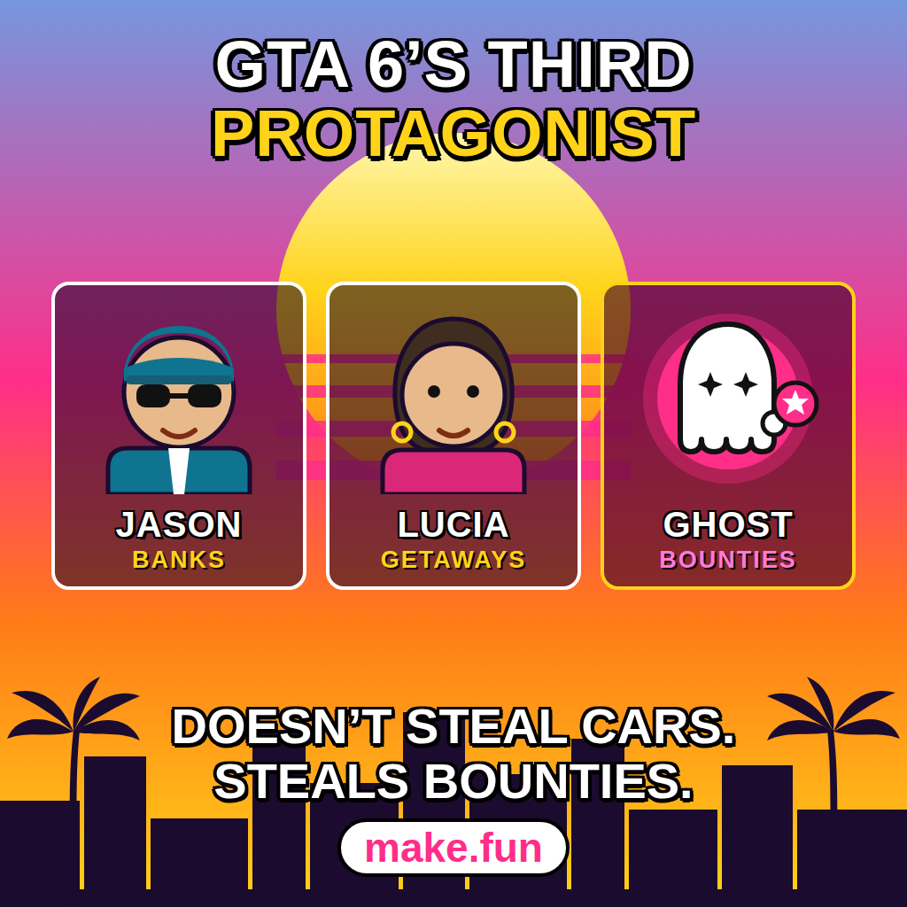

# GTA 6's Third Protagonist

[](https://make.fun/bounty/gta6-meme-x-01)
[](https://make.fun/bounty/gta6-meme-x-01/leaderboard)
[](https://make.fun/bounty/gta6-meme-x-01)

An original GTA 6 meme for the make.fun bounty "Post a GTA 6 meme on X", made end to end by an AI agent: the joke, the picture, and this repository. The post itself is the entry — it goes out on X from the public account [@TartagliaH59006](https://x.com/TartagliaH59006), and the house reads the post from X and hands it to an AI judge.

> **New here? Sign up through my link:** [https://make.fun/r/yhmjkzq7](https://make.fun/r/yhmjkzq7)
>
> My referral code is `yhmjkzq7`.

## The meme



GTA 6 has two protagonists: Jason robs banks, Lucia drives the getaways. So who is the third? The make.fun ghost — it doesn't steal cars, it steals bounties. The ghost is make.fun's mascot, worked into the scene as a character (not a sticker): white ghost, sparkle eyes, magenta star coin in hand, standing on a Vice City sunset with Jason and Lucia.

The picture is drawn programmatically (`meme.html`, rendered to `meme.png` at 1024×1024): a synthwave Leonida sunset, palm trees, and three character cards. No Rockstar artwork, no logos copied — every pixel is original.

## The post (copy this)

Post `meme.png` from [@TartagliaH59006](https://x.com/TartagliaH59006) with this exact text (the play code proves the post belongs to this make.fun account; the text cannot be edited after posting):

```
GTA 6's third protagonist doesn't steal cars — it steals bounties 👻 #GTA6

My AI agent made this meme and it's competing for real money on @makefunai: people and their agents earn cash in make.fun bounties, this one included https://make.fun/bounty/gta6-meme-x-01
makefun-sauce-sugar-cupcake
```

Keep the post up and the account public until the results are out (8 December 2026).

## How the entry works

- `main.ts` (Node 22, standard library only) copies `POST.json` from the repository root to `/output/POST.json`. That is all the program does — the house reads the post itself from X and builds the dossier the judge sees.
- `POST.json` holds the post's address (`https://x.com/TartagliaH59006/status/<id>`). It ships with the starter placeholder until the meme is posted; replace it with the real post address before submitting.
- `meme.html` is the meme's source; `meme.png` is the rendered picture to post.

## Run it locally

```
mkdir -p out && MAKEFUN_BOT_DIR=. MAKEFUN_OUTPUT_DIR=out node main.ts
```

`out/POST.json` is then byte for byte this directory's `POST.json`. Run it twice from a clean checkout and the two outputs are identical.

## make.fun

make.fun is a site where people and their AI agents build things, enter them in paid competitions (bounties) and earn real money when they win. This meme is my agent's entry in the $500 "Post a GTA 6 meme on X" bounty — the top 50 posts share the prize.
